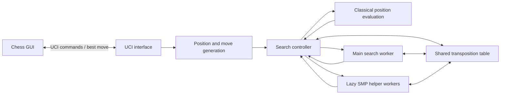

  

<h1 align="center">Pacu</h1>

  An independently developed chess engine, written in Rust.
   
  Search the position. Find the move.

  
  
  

> These repository badges describe this public project page, not the private engine source repository.

Pacu is a UCI-compatible chess engine developed independently in Rust. It began as a Python engine and was later rewritten in Rust, with documented work on classical evaluation, search, transposition-table correctness, parallel search, and testing.

This repository is Pacu's public project page. **The engine source remains private and is not published here**, and no downloadable builds are currently available. The project may be open-sourced in the future; planned releases are intended to provide user-downloadable binaries without the source code.

## At a glance

| | |
|---|---|
| **Engine** | Rust rewrite of an earlier Python chess engine |
| **Interface** | Universal Chess Interface (UCI) |
| **Game** | Standard chess |
| **Evaluation** | Classical, hand-crafted; middlegame/endgame tapered |
| **Search** | Iterative deepening, Principal Variation Search, quiescence search |
| **Parallel search** | Lazy SMP; configurable from 1 to 32 threads |
| **Distribution** | No public engine source or downloadable build yet |

## Playing strength

Ratings depend on the tested build and match conditions. The absolute estimate below and the later head-to-head result answer different questions; neither should be read as an official over-the-board rating.

| Tested build | Result | Match |
|---|---|---|
| **Pacu 1.0.0 / Part I** | **2236.2 ± 8.7 Elo** (95% confidence interval), 59.9% score | 7,120-game gauntlet vs. Stockfish 17.1 strength anchors |
| **Part IV development build** | **+127.0 ± 27.4 Elo** (95% confidence interval), 67.5% score | 300 paired games vs. Part III |

**Absolute estimate — Pacu 1.0.0 / Part I.** This result uses Stockfish 17.1's nominal `UCI_Elo` anchors at 1950, 2050, 2150, 2250, and 2350. Games used 0.25 seconds per move, 64 MB hash, one thread per engine, randomized openings with colors paired, and six concurrent games on Windows 11 / an AMD Ryzen 5 5600. The estimate is on that Stockfish scale at that time control—not a FIDE, CCRL, or universal rating. It applies to the tested Part I build, not the later Part IV development build.

**Relative result — Part IV vs. Part III.** Part IV, running four threads, scored 67.5% (+129 =147 -24) over 300 paired games at 100 ms per move against the single-threaded Part III build. The +127.0 Elo estimate measures the difference between those two builds under that match setup; it is **not** Part IV's absolute rating. Part IV has not received an absolute overnight rating.

Absolute-rating match results by Stockfish anchor

Each anchor played 1,424 games in the 7,120-game gauntlet.

| Stockfish nominal `UCI_Elo` | Pacu score |
|---:|---:|
| 1950 | 74.2% |
| 2050 | 64.7% |
| 2150 | 62.1% |
| 2250 | 49.8% |
| 2350 | 48.6% |

The estimate was fitted by Ordo with a 95% error interval. Stockfish's nominal ratings are treated as fixed anchors; results should be compared only with care across different versions, time controls, and anchor ladders.

## Development history

The dates and milestones below are taken from the engine changelog, frozen-baseline notes, and benchmark records. The supplied engine folder has no Git history, and the original Python project's start date is not recorded.

| Date | Milestone | What changed |
|---|---|---|
| Date undocumented | Original Python engine | Initial Pacu implementation; later reviewed as the predecessor to the Rust rewrite. |
| 2026-11-13 | Rust 1.0.0 | Dependency-free Rust rewrite with UCI, classical evaluation, search, perft and test tooling. |
| 2026-11-13 | Part I — tapered evaluation | Added middlegame/endgame evaluation terms; this snapshot later became the subject of the 7,120-game absolute rating. |
| 2026-11-14 | Part II — search and move ordering | Added a per-ply search stack, improving detection, capture and continuation history, reverse futility pruning, and refined late-move reductions; measured against Part I. |
| 2026-11-14 | Part III — transposition table and correctness | Added a clustered transposition table and broader board-invariant testing. Its A/B result was statistically neutral; the work was retained for correctness and diagnostics. |
| 2026-11-15 | Part IV — Lazy SMP | Added shared-table parallel search and the UCI `Threads` option. A four-thread build was measured against Part III. |
| 2026-11-15 | Part VI — testing and measurement | Expanded the tactical suite to 23 positions and recorded an 11-gate release check. The Part IV absolute rating remains outstanding. |

The numbered parts are development milestones, not separate public releases. The Part V NNUE document is planning only; implementation has not started.

## Features

### Available in the documented Rust engine

- UCI protocol support and FEN position input.
- Standard chess move generation, including castling, en passant, and promotions.
- Classical evaluation with material and piece-square scores tapered between middlegame and endgame.
- Pawn structure and passed-pawn terms, bishop-pair bonuses, mobility, piece activity, and king-safety terms.
- Iterative deepening, Principal Variation Search, aspiration windows, and move ordering.
- Transposition-table reuse, null-move and late-move pruning/reductions, and quiescence search with check evasions.
- Repetition and fifty-move draw detection.
- Lazy SMP parallel search with a shared transposition table.
- UCI search limits for depth, move time, clocks and increments, nodes, and infinite analysis.

### Not currently provided

- Chess960.
- NNUE evaluation (a design document exists; implementation has not started).
- A built-in opening book.
- Pondering.
- Syzygy tablebase support.

## How Pacu works

Pacu receives a position and search limits from a UCI-compatible GUI. It generates legal moves, searches candidate continuations, evaluates positions, and returns a best move. The GUI—not Pacu—provides the board display and player-facing controls.

The diagram shows the documented high-level design. Search workers maintain their own search state and cooperate through the shared transposition table; the public project page does not include the engine implementation.

At a high level, evaluation combines material and piece placement with position-dependent terms such as pawn structure, passed pawns, mobility, piece activity, and king safety. Search deepens iteratively, uses Principal Variation Search and move ordering to focus on promising lines, and applies pruning and quiescence search to manage the tree. The transposition table caches search information for reuse. Lazy SMP lets multiple workers explore concurrently while sharing that table.

## Architecture and implementation

The Rust engine uses a mailbox board representation with precomputed attack tables, incremental Zobrist hashing, and make/unmake move updates. Its evaluator is classical rather than neural. Search uses per-ply state and move-history information; the transposition table is clustered and shared by Lazy SMP workers.

This is a technical overview, not a source-code publication. The engine sources and build files are not included in this repository.

## Testing and reliability

Recorded validation for the Part IV Rust development build:

| Check | Result | What it covers |
|---|---:|---|
| Rust automated tests | **65 passed** | Evaluation and search behavior, board invariants, transposition-table behavior, perft, self-play legality, and UCI search/stop lifecycle. |
| Perft suite | **11/11 positions** | Legal move-generation counts compared with established expected counts. |
| Tactical regression suite | **23/23 positions** | Fixed-depth move or forced-mate expectations, including quiet wins, defensive resources, and exchange sacrifices. |
| Automated release gate | **11/11 checks** | Formatting, Clippy, tests, release build and binary hash, perft, tactics, GUI and threaded-UCI smoke checks, benchmarks, and an SPRT harness smoke test. |

Passing these checks is evidence for the tested behaviors and snapshot; it is not a guarantee of perfect chess correctness or playing strength.

## Releases and availability

There are currently **no GitHub Releases and no downloadable engine builds** in this repository. The `1.0.0` label below is the version recorded in the supplied engine changelog; it is not a published GitHub Release.

| Version / snapshot | Highlights | Availability |
|---|---|---|
| 1.0.0 / Part I | Rust engine milestone; historical absolute-strength measurement | No public binary; source is not published here |
| Part IV development build | Lazy SMP; 4-thread relative match result vs. Part III | No public binary; source is not published here |

Future releases are intended to provide prebuilt binaries for users without publishing the engine source code.

## Using Pacu

When a downloadable build is available, users will be able to configure its executable as a UCI engine in a compatible chess GUI. **There is no executable to install from this project page yet**, so installation commands are not provided.

The documented Rust engine exposes these UCI options:

| Option | Default | Description |
|---|---:|---|
| `Hash` | 64 MB | Transposition-table memory; configurable from 1 to 4096 MB. |
| `Threads` | 1 | Search workers; configurable from 1 to 32. |
| `Move Overhead` | 10 ms | Time reserved for GUI and communication overhead. |
| `Clear Hash` | — | Clears cached transposition-table and search information. |

## Roadmap

**Completed and documented**

- Rust rewrite and UCI support.
- Classical tapered evaluation and successive search improvements.
- Clustered transposition table and board-correctness work.
- Lazy SMP parallel search.
- Tactical regression suite, SPRT harness, and automated release gate.

**Next**

- Complete an absolute overnight rating measurement for the Part IV frozen build.
- Continue strength testing and development documentation.
- Prepare user-downloadable binary releases when they are ready.

**Future possibilities — not started**

- NNUE evaluation (design/planning only).
- Classical evaluation parameter tuning and further search experiments.
- Opening book or Syzygy tablebase support.

## Contributing and reporting problems

Issues are open for error reports and project feedback. Please include the Pacu build or snapshot, operating system, GUI, steps to reproduce, and expected versus actual behavior. Remove personal information and secrets from logs.

Pull requests are welcome for documentation and project-page improvements. Since engine source is not published here, a pull request to this repository cannot change the engine itself.

## Tools and acknowledgements

Pacu uses the UCI protocol and is implemented in Rust. Recorded validation and rating work uses [Stockfish](https://github.com/official-stockfish/Stockfish), [Fastchess](https://github.com/Disservin/fastchess), [Ordo](https://github.com/michiguel/Ordo), [python-chess](https://github.com/niklasf/python-chess), and tactical studies from Win At Chess. These are testing and measurement tools; they are not contributors to Pacu.
