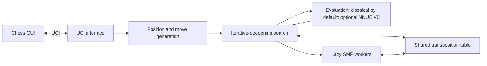

  

<h1 align="center">Pacu</h1>

An independently developed chess engine in Rust.

Pacu is a UCI chess engine for standard chess. Its development began with a Python engine and has since moved to a dependency-free Rust engine, with measured search improvements, a parallel searcher, and a growing correctness and match-testing suite.

**This is Pacu's public project page, not its source repository.** The engine and companion bot source are private and are not published here. Open-sourcing the project is planned, but no source release or downloadable engine build is available yet.

## Playing strength

The results below refer to different engine snapshots and different kinds of comparison. The Part I rating is an absolute estimate against fixed Stockfish anchors; the Part II–IV figures are relative head-to-head results.

### Absolute estimate

| Snapshot | Estimate | Test |
|---|---:|---|
| Pacu 1.0.0 / Part I | **2236.2 ± 8.7 Elo** (95% interval), 59.9% score | 7,120 games vs. Stockfish 17.1 |

The gauntlet used Stockfish's nominal `UCI_Elo` anchors at 1950, 2050, 2150, 2250, and 2350; 250 ms per move; 64 MB hash; one thread per engine; paired random openings; and six concurrent games on Windows 11 / Ryzen 5 5600. The estimate is specific to this build, Stockfish's anchor scale, and this time control. It is not a FIDE, CCRL, or universal rating.

Results by Stockfish anchor

Each anchor played 1,424 games.

| Stockfish nominal `UCI_Elo` | Pacu score |
|---:|---:|
| 1950 | 74.2% |
| 2050 | 64.7% |
| 2150 | 62.1% |
| 2250 | 49.8% |
| 2350 | 48.6% |

### Paired comparisons

| Candidate vs. reference | Games | Candidate score | Estimated difference (95% interval) |
|---|---:|---:|---:|
| Part II vs. Part I | 300 | 55.5% | +38.4 ± 30.5 Elo |
| Part III vs. Part II | 600 | 48.9% | −7.5 ± 27.8 Elo |
| Part IV (`Threads=4`) vs. Part III (`Threads=1`) | 300 | 67.5% (+129 =147 −24) | +127.0 ± 27.4 Elo |

These are relative results at 100 ms per move, not absolute ratings. Part III's result is statistically neutral. Part IV has not had an absolute overnight rating run; the later NNUE V0 and engine-hardening work has no strength claim.

## The engine

Pacu communicates with a chess GUI through UCI. The GUI supplies positions and search limits; Pacu returns moves. Pacu does not include a board interface.

The default evaluator is classical and hand-crafted: material and piece-square scores are tapered between middlegame and endgame, with additional terms for pawn structure, passed pawns, bishop pairs, mobility, piece activity, and king safety. Search uses iterative deepening, Principal Variation Search, move ordering, pruning, quiescence search, and a transposition table.

The engine also has an experimental **NNUE V0** path: a versioned network loader and scalar inference implementation. It is off by default, recomputes its accumulator for each evaluation, and has only a synthetic test network—not a trained network or strength-tested configuration. The classical evaluator remains the default.

Lazy SMP runs independent search workers that share a transposition table. The engine supports standard chess, FEN positions, and UCI limits for depth, time, clocks and increments, nodes, and infinite analysis.

| UCI option | Default | Description |
|---|---:|---|
| `Hash` | 64 MB | Transposition-table size (1–4096 MB). |
| `Threads` | 1 | Search workers (1–32). |
| `Move Overhead` | 10 ms | Time reserved for GUI and communication overhead. |
| `Clear Hash` | — | Clears cached search information. |
| `Use NNUE` | false | Selects NNUE evaluation when a network is loaded. |
| `EvalFile` | empty | Path to a Pacu network file; no trained network is distributed. |

Chess960, a built-in opening book, pondering, and Syzygy tablebase support are not currently provided.

## Development

The milestone dates below come from the engine changelog, frozen-baseline notes, and test records. The engine source history is not part of this public repository.

| Date | Milestone |
|---|---|
| Date not recorded | The original Python engine was developed; it is now kept as a frozen reference. |
| 2026-11-13 | Rust engine 1.0.0 and the Part I tapered evaluation. |
| 2026-11-14 | Part II search and move-ordering work; Part III clustered transposition table and board-correctness work. |
| 2026-11-15 | Part IV Lazy SMP; expanded tactical and release-gate tooling. |
| 2026-11-16 | NNUE V0 loader, scalar inference, fixture, and UCI options. |
| 2026-11-18 | First live Lichess bot validation; a repetition-draw issue found in play was fixed and covered by tests. |
| 2026-11-19 | Engine hardening, repository reorganization, and Linux service deployment for the separate Lichess bot. |

The numbered parts are development milestones, not public releases. NNUE V1—incremental accumulators and a trained network—has not started. The Part IV absolute rating is deferred and unmeasured.

## Testing

Development validation for the current Rust engine and companion bot:

| Check | Result |
|---|---:|
| Engine tests (`cargo test --release`) | **111 passed** |
| Bot tests (`cargo test --release`, separate crate) | **46 passed**, including a mock Lichess game |
| Perft positions | **11/11 matched** |
| Tactical regression positions | **23/23 passed** |
| Engine release gate (2026-11-19) | **11/11 checks passed** |

The release gate includes formatting, Clippy, tests, release build and binary hash, perft and tactics, GUI and threaded-UCI smoke checks, benchmarks, and an SPRT harness smoke test. These results cover specific development snapshots and tests; they are not a guarantee of perfect correctness or playing strength.

## Lichess bot

A separate Rust client runs the [Pacu Bot account on Lichess](https://lichess.org/@/Pacu_Bot). It accepts supported standard-chess challenges and connects each game to an engine process over UCI. The bot was live-validated in November 2026. Its source and self-hosting builds are not included in this repository.

## Releases and availability

There are **no GitHub Releases or downloadable engine builds** here. `1.0.0` is the version recorded in the private engine crate's development files; it is not a public GitHub Release.

| Version or snapshot | Notes | Availability |
|---|---|---|
| 1.0.0 / Part I | Rust engine snapshot used for the absolute rating estimate | No public build |
| Part IV | Lazy SMP snapshot used in the relative match vs. Part III | No public build |
| Current development | NNUE V0 and later reliability work; no strength result | No public build |

When builds are ready, the project plans to publish user-downloadable binaries. No release date has been announced.

## Contributing and reporting problems

Use [GitHub Issues](https://github.com/theveryheavy/Pacu/issues) to report errors or unexpected behavior. Include the engine snapshot, operating system, GUI, reproduction steps, and expected versus actual behavior; remove private information from logs.

Pull requests for documentation and this project page are welcome. Since the engine source is not published here, changes to this repository cannot change the engine or bot.

## Testing tools

Strength and correctness work uses [Stockfish](https://github.com/official-stockfish/Stockfish) as an opponent and reference, [Fastchess](https://github.com/Disservin/fastchess) and [Ordo](https://github.com/michiguel/Ordo) for match and rating analysis, [python-chess](https://github.com/niklasf/python-chess) for move-generation checks, and tactical studies from Win At Chess.
